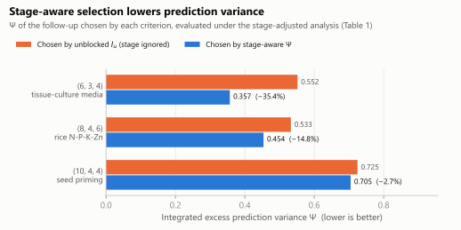
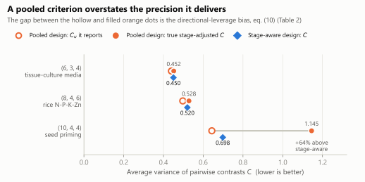
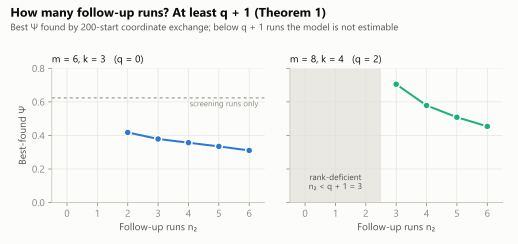

# Stage-aware follow-up designs for definitive screening experiments

**Exact criteria, rank completion and pooled-criterion bias**

Lunganlung P. G. and Prabhakar Verma
Division of Agricultural Statistics, The Graduate School, ICAR-Indian Agricultural Research Institute, New Delhi-110012, India.

[](https://lunganlungpg.github.io/stage-aware-dsd-followup/)


> **Read the paper:** <https://lunganlungpg.github.io/stage-aware-dsd-followup/>
> It has the full text, with an explorer where you drag follow-up runs and watch Ψ, C, C_u, the stage-confounding index *h* and the directional leverage update live. It also has an interactive run-count rule (Fig. 1) and an exhaustive projection-rank audit that runs in your browser.

## Abstract

A definitive screening design is often followed by a small second batch of runs on the factors that appear active, and the analysis of the combined data then includes a fixed stage effect. We study how these follow-up runs should be chosen. Profiling the unrestricted stage shift yields closed forms for the integrated variance of baseline prediction and of pairwise differences between factor settings, which are distinct design criteria. We give an index of stage confounding with an exact expression for the cost of fitting the stage effect, and an identity showing that a pooled contrast criterion overstates precision by a term governed by the directional leverage of the between-stage regressor displacement. When the projected screening design has rank deficiency *q*, we show that at least *q* + 1 follow-up runs are needed to restore full rank and that *q* + 1 runs suffice for suitably placed points. For computation, we derive a centred rank-two update for coordinate exchange, a trace lower bound and a convex-relaxation lower bound. In three screening projections, stage-aware selection reduced integrated excess prediction variance by 2.7–35.4% relative to selection by the unblocked criterion; in a rank-saturating case, pooled contrast selection chose a design whose stage-adjusted contrast variance was 64% higher than that of the stage-aware design.

## Key results at a glance

The labels match the paper's agricultural examples. *(m, k, n*₂*)* means a *k*-factor projection of an *m*-factor DSD, followed by *n*₂ follow-up runs in a second season or batch.

**1. Ignoring the stage effect when you choose follow-up runs costs precision.** The unblocked criterion *I*<sub>u</sub> treats the second batch as if it ran under the same conditions as the first. The stage-aware criterion Ψ instead accounts for the season or batch shift that the analysis will fit. Choosing by Ψ cut the integrated excess prediction variance by up to 35.4%.



**2. A pooled criterion reports better precision than it delivers.** The pooled contrast criterion *C*<sub>u</sub> scores its own design as more precise than it really is. The gap equals the directional leverage of the between-stage shift. In the rank-saturating seed-priming case, the design chosen by *C*<sub>u</sub> has a true stage-adjusted contrast variance 64% higher than the stage-aware design's.



**3. How many follow-up runs?** If the projected screening design has rank deficiency *q*, at least *q* + 1 follow-up runs are needed before the full second-order model can be estimated, and *q* + 1 well-placed runs are enough (Theorem 1). Each run added after that gives a smaller gain.



All three figures are drawn from the stored designs in [`data/`](data/) by [`python/examples/make_figures.py`](python/examples/make_figures.py). For interactive versions, see the [preprint](https://lunganlungpg.github.io/stage-aware-dsd-followup/).

## Repository layout

| Path | Contents |
|---|---|
| [`docs/index.html`](docs/index.html) | Interactive preprint, served with GitHub Pages. It is self-contained and all computation runs in the browser. |
| [`docs/figures/`](docs/figures/) | The README figures (SVG), generated by `python/examples/make_figures.py` |
| [`python/`](python/) | `stageaware` Python package: criteria (Props 1–3), Theorem 1 run counts, rank-two coordinate exchange (Prop 4), lower bounds (Prop 5, Thm 2), and tests that reproduce the paper's tables |
| [`R/stageaware/`](R/stageaware/) | `stageaware` R package (base R only) with the same criteria, diagnostics and coordinate exchange |
| [`R/reproduce_tables.R`](R/reproduce_tables.R) | Recomputes Tables 1–2 in R without installing anything |
| [`data/selected_designs/`](data/selected_designs/) | Coded coordinates of every selected design in Tables 1–3 |
| [`data/run_count_trajectory.csv`](data/run_count_trajectory.csv) | Best-found Ψ against *n*₂ (Fig. 1) |

## Quick start

### Python

```bash
pip install "git+https://github.com/lunganlungpg/stage-aware-dsd-followup#subdirectory=python"
```

```python
import numpy as np
from stageaware import FollowUpProblem, dsd, coordinate_exchange

P = FollowUpProblem(dsd(10)[:, :4])        # 4-factor projection of the 10-factor DSD
print(P.r1, P.q)                           # 12, 3  ->  Theorem 1: at least q+1 = 4 follow-up runs

res = coordinate_exchange(P, n2=4, criterion="psi", n_starts=20, seed=1)
print(res.value)                           # stage-aware excess variance Psi
print(P.summary(res.X2))                   # Psi, C, C_u, I_u, h, leverage, rank, residual df, ...
```

Reproduce the tables: `python python/examples/reproduce_tables.py`. Redraw the README figures (needs `matplotlib`): `python python/examples/make_figures.py`. Run the tests: `pytest python/tests`.

### R

```r
remotes::install_github("lunganlungpg/stage-aware-dsd-followup", subdir = "R/stageaware")
library(stageaware)

P <- followup_problem(dsd(6)[, 1:3])
res <- coordinate_exchange(P, n2 = 4, criterion = "psi", n_starts = 20)
design_summary(P, res$X2)
```

To run without installing, use `Rscript R/reproduce_tables.R` from the repository root.

## What is checked

The test suites recompute these values from the stored designs and compare them with the paper:

- Table 1 (Ψ for the aware and naive designs, *h*, *r*₁, *q*) and Table 2 (*C* and *C*<sub>u</sub> for all designs);
- Section 5.4: ‖Δ‖, the smallest eigenvalue of **S**, the leverage Δ′**S**⁻¹Δ and the penalty (10);
- Section 5.5: projection-rank counts for *m* = 5,…,14 and the lower bounds 0.1949 (Prop 5), 0.3331 and 0.3327 (Thm 2);
- identities (4), (5), (7), (8), (9), (10) and (11)–(12) to machine precision.

## Citation

```bibtex
@misc{lunganlung2026stageaware,
  title  = {Stage-aware follow-up designs for definitive screening experiments:
            exact criteria, rank completion and pooled-criterion bias},
  author = {{Lunganlung P. G.} and Verma, Prabhakar},
  year   = {2026},
  note   = {Preprint},
  url    = {https://github.com/lunganlungpg/stage-aware-dsd-followup}
}
```

## License

Code is released under the [MIT License](LICENSE). The manuscript text is © the authors.
